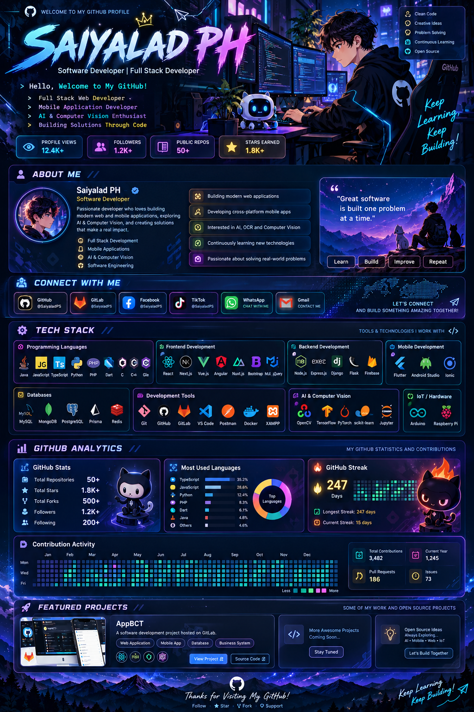

<!-- GitHub Profile README: keep the assets/ folder alongside this file. -->
<div align="center">



<sub>🎨 Concept artwork — the statistics shown inside the illustration are decorative, not live GitHub data.</sub>

</div>

---

<div align="center">


<br />

[](https://github.com/SaiyaladPS)
[](https://gitlab.com/SaiyaladPS)

[](https://github.com/SaiyaladPS?tab=followers)

</div>

---

## 👨‍💻 About Me

```typescript
const developer = {
  name: "Saiyalad PH",
  focus: ["Full Stack", "Mobile", "AI & Computer Vision"],
  philosophy: "Keep learning. Keep building."
};
```

- 💻 Building practical web and software solutions
- 📱 Exploring cross-platform mobile applications
- 🤖 Interested in OCR, AI and computer vision
- 🚀 Always learning new technologies and improving my craft

---

## 🛠️ Tech Universe

<div align="center">

### 💻 Languages


### 🎨 Frontend


### ⚙️ Backend


### 📱 Mobile


### 🗄️ Databases & Data


### 🔧 Developer Tools & Computer Vision


### 🔌 IoT & Hardware


<br />


</div>

---

## 📊 GitHub Analytics

<div align="center">


### 🔥 Contribution Streak


### 📈 Contribution Activity


</div>

---

## 🚀 Featured Project

### 📱 AppBCT

A software development project hosted on GitLab.

[](https://gitlab.com/SaiyaladPS/app-bct)

---

<div align="center">

### 💡 Developer Mindset

> Great software is built one problem at a time.

**LEARN · BUILD · IMPROVE · REPEAT**

### ⭐ Thanks for visiting!


</div>
